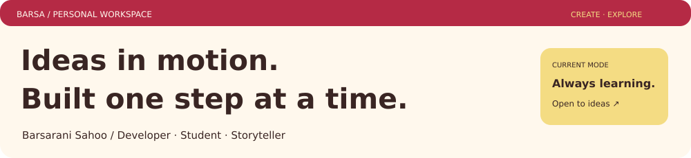
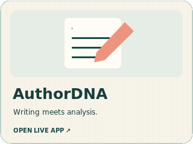
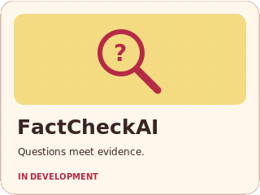

  

<table>
<tr>
<td width="30%" align="center">

 Barsarani Sahoo · @barsa-dot
</td>
<td width="70%">
<h3>Hello, I'm Barsa.</h3>

I study Computer Science at <b>REVA University</b> and BBA (DBE) at <b>IIM Bangalore</b>.

I enjoy building web applications, exploring language and machine learning, and making useful tools with a little personality.

<b>Currently exploring:</b> full-stack development, data structures and database systems.

</td>
</tr>
</table>

  
  
  

### Pick a project

  
  
  

[Open AuthorDNA ↗](https://authordna.onrender.com/) · [Open TaskNest ↗](https://mytasknest.pages.dev/) · **FactCheckAI: in development**

### My toolkit

**Languages** · C · C++ · Python · JavaScript · TypeScript · SQL  
**Web** · React · Tailwind CSS · FastAPI · Node.js  
**Tools** · Git · GitHub · VS Code

Curious by default. Building with intention.

