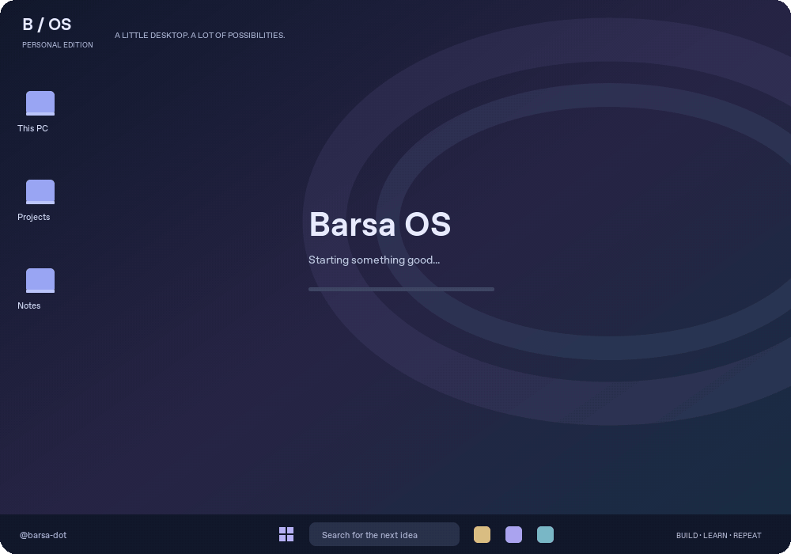
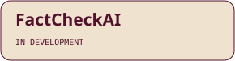

  

  
  
  

  <a href="https://barsa-dot.github.io/barsa_portfolio/">PORTFOLIO ↗</a> &nbsp; · &nbsp;
  <a href="https://www.linkedin.com/in/barsarani-sahoo/">LINKEDIN ↗</a> &nbsp; · &nbsp;
  <a href="https://github.com/barsa-dot?tab=repositories">EXPLORE MY REPOS ↗</a>

### About the person behind the desktop

I'm **Barsarani Sahoo**, a Computer Science student at **REVA University** and a **BBA (DBE) student at IIM Bangalore**. I enjoy turning ideas into things people can use—from web applications and AI experiments to games and developer tools.

### Open a project

| Project | What I’m building |
| :--- | :--- |
| **[AuthorDNA ↗](https://authordna.onrender.com/)** | A writing analysis tool exploring writing style and language patterns. |
| **FactCheckAI — in development** | Machine learning experiments for assessing claims using text datasets. |
| **[TaskNest ↗](https://mytasknest.pages.dev/)** | A task manager with subtasks, progress tracking and a playful rewards system. |

### My toolkit

**Languages** · C · C++ · Python · JavaScript · TypeScript · SQL  
**Web** · React · Tailwind CSS · FastAPI · Node.js  
**Tools** · Git · GitHub · VS Code

---

Curious by default. Building with intention.

