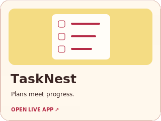
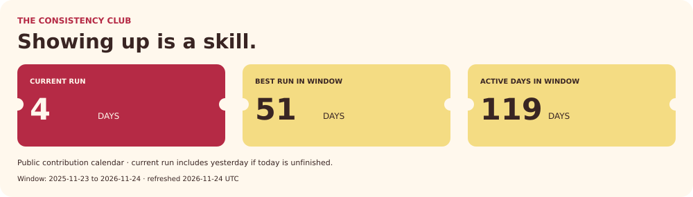

  

### A little about my workbench

I’m **Barsarani Sahoo**, studying Computer Science at **REVA University** and BBA (DBE) at **IIM Bangalore**. I build web applications and explore language, machine learning and creative interfaces.

**Now exploring:** data structures · databases · full-stack development

  
  
  

### Pick a project

  
  
  

[Open AuthorDNA ↗](https://authordna.onrender.com/) · [Open TaskNest ↗](https://mytasknest.pages.dev/) · **FactCheckAI: in development**

### Follow the daily thread

A streak counts consecutive active calendar days. Today can remain unfinished: an active streak through yesterday is retained. The longest streak covers the displayed calendar window, not all-time history. Public activity only.

### My toolkit

**Languages** · C · C++ · Python · JavaScript · TypeScript · SQL  
**Web** · React · Tailwind CSS · FastAPI · Node.js  
**Tools** · Git · GitHub · VS Code

Curious by default. Building with intention.

