<p align="center">
  
</p>

<p align="center">
  <a href="https://barsa-dot.github.io/barsa_portfolio/">PORTFOLIO ↗</a> &nbsp; · &nbsp;
  <a href="https://www.linkedin.com/in/barsarani-sahoo/">LINKEDIN ↗</a> &nbsp; · &nbsp;
  <a href="https://github.com/barsa-dot?tab=repositories">EXPLORE MY REPOS ↗</a>
</p>

### `whoami`

I'm **Barsarani Sahoo**, a Computer Science student at **REVA University** and a **BBA (DBE) student at IIM Bangalore**. I enjoy turning ideas into things people can use—from web applications and AI experiments to games and developer tools.

```python
barsa = {
    "interests": ["full-stack development", "AI", "creative interfaces"],
    "learning":  ["data structures", "C++", "database systems"],
    "approach":  "build it, understand it, make it better",
}
```

### `ls projects/`

| Project | What's inside |
| :--- | :--- |
| **[Developer OS](https://github.com/barsa-dot/developer-os)** | A creative developer interface with an arcade-inspired personality. |
| **[Arcade 2.0](https://github.com/barsa-dot/Arcade2.0)** | Python games, brought together in one arcade. |
| **[The Museum of Barsa](https://github.com/barsa-dot/the-museum-of-barsa)** | An experiment in making a portfolio feel like a place to explore. |
| **[Portfolio](https://github.com/barsa-dot/barsa_portfolio)** | My personal corner of the web. |

### `cat toolbox.txt`

**Languages** · C · C++ · Python · JavaScript · TypeScript · SQL  
**Web** · React · Tailwind CSS · FastAPI · Node.js  
**Tools** · Git · GitHub · VS Code

---

<p align="center"><sub>Part developer. Part storyteller. Always a work in progress.</sub></p>
